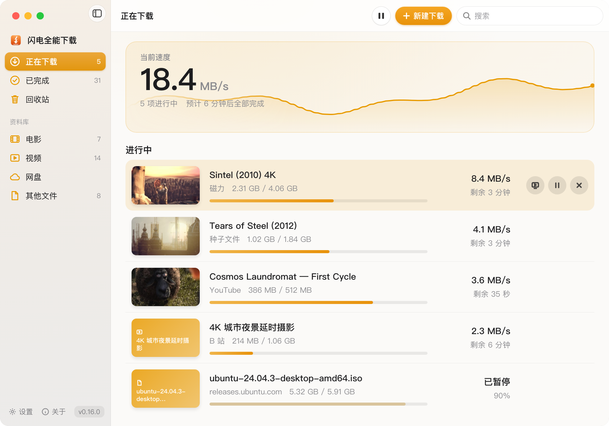

<div align="center">


# 闪电全能下载

**原生 macOS 下载工具**

在一个窗口中管理磁力链接、种子、ed2k、HTTP 直链、网盘直链，<br>
以及 YouTube、哔哩哔哩、抖音、小红书等平台的视频下载

浏览器扩展一键接管 · 边下边播 · 断点续传 · 云盘离线加速

简体中文 | [English](README.en.md)




</div>

闪电全能下载是一款面向 Mac 的开源下载工具，将磁力链接、种子、ed2k、HTTP 直链、网盘直链以及主流视频平台的下载整合在同一个窗口中管理。复制链接后在窗口中按 ⌘V 即可添加任务，链接类型自动识别；配合浏览器扩展，网页上的下载会直接交由本应用接管。

应用基于 SwiftUI 原生开发，下载内核为 [Gopeed](https://github.com/GopeedLab/gopeed) 的定制版本，视频平台下载由 [yt-dlp](https://github.com/yt-dlp/yt-dlp) 提供支持。

## 支持的下载类型

| 类型 | 添加方式 |
| --- | --- |
| 磁力链接、种子文件、ed2k | 复制链接后按 ⌘V，或将种子文件拖入窗口 |
| HTTP / HTTPS 文件 | 复制链接后按 ⌘V；安装浏览器扩展后，网页上的下载自动接管 |
| YouTube、X、哔哩哔哩、微博 | 复制视频页链接后按 ⌘V |
| 抖音、小红书、新片场 | 在浏览器中打开视频页，通过浏览器扩展发送 |
| 百度网盘等网盘文件 | 通过 [LinkSwift](https://greasyfork.org/scripts/583582-linkswift) 用户脚本获取直链后发送（需另行安装） |

视频平台默认下载最高可用画质，优先选择 H.264 视频与 AAC 音频，可直接导入剪映、Final Cut Pro 等剪辑软件；抖音、小红书视频不带平台水印。目前不支持微信视频号。

## 下载性能

- **磁力任务启动快**：每次启动时从公开列表合并获取最新 tracker，并固定 BT 监听端口以便其他节点连入。使用公开片源测试，磁力链接 5–18 秒开始下载
- **HTTP 多连接下载**：大文件分段并行下载，每段不小于 20 MB；服务器返回限流（429）或临时错误（5xx）时自动退避重试，连续 3 分钟无进展才判定失败，避免任务长期停在「下载中」
- **视频分片并发**：YouTube 等平台按 4 路分片并发下载，测试中速度由 1.4–1.6 MiB/s 提升至 3.4–4.1 MiB/s
- **冷门资源云端离线（可选）**：BT 网络中无人分享的资源，可交由 PikPak 服务器先行下载，再从云盘拉回本地
- **按域名分流代理**：读取系统代理设置，境外站点经代理下载，国内站点与 BT 任务直连，无需手动切换

> 以上数据为作者在本机网络环境下的实测结果，实际速度取决于网络条件与资源热度。

## 功能特性

<div align="center">

</div>

- **资料库自动分类**：任务按电影、视频、网盘、其他文件归类，已完成的影片以画面缩略图展示，双击即可打开
- **边下边播**：电影下载过程中可直接播放，拖动进度条时优先下载对应片段
- **断点续传**：关闭窗口后下载在后台继续，菜单栏显示实时速度；退出应用后再次打开，未完成的任务自动恢复，无需重新校验
- **剪贴板监测**：在其他应用中复制下载链接时，屏幕右上角弹出提示，点击即可开始下载
- **下载设置**：可分别设置磁力 / 种子、视频平台、其他文件的保存位置，以及同时下载数与全局限速
- **回收站**：移除的任务保留记录，可随时重新下载
- **完成提醒**：下载完成时发送系统通知并播放提示音

## 系统要求

- macOS 14 或更新版本
- Apple 芯片（M 系列）或 Intel 处理器的 Mac，两种芯片分别提供安装包
- 下载视频平台内容需要 ffmpeg（用于合并音视频，安装方式见下文）

## 安装

### 方式一：命令行安装（推荐）

打开「终端」，粘贴以下命令并回车：

```bash
curl -fsSL https://raw.githubusercontent.com/chenmozhe008/shandian-download/master/script/install.sh | bash
```

脚本会下载最新版本，安装到「应用程序」文件夹并打开，同时跳过系统的「无法验证开发者」拦截；如已安装 [Homebrew](https://brew.sh)，会一并安装 ffmpeg。再次运行同一命令即可更新。

### 方式二：通过 AI 助手安装

使用 Claude Code、Codex、WorkBuddy 等 AI 助手时，可将以下内容发送给它：

> 请帮我安装「闪电全能下载」（https://github.com/chenmozhe008/shandian-download）：在终端运行 `curl -fsSL https://raw.githubusercontent.com/chenmozhe008/shandian-download/master/script/install.sh | bash`。装好后，一步步告诉我怎么在浏览器里装它的扩展。

<details>
<summary>给 AI 助手的说明</summary>

- 安装脚本 `script/install.sh` 可以重复运行（覆盖旧版，旧版移到废纸篓）；要求 macOS 14+，按芯片自动选择 AppleSilicon / Intel 安装包。加 `-s -- --no-ffmpeg` 可不装 ffmpeg
- 浏览器不允许程序自动安装扩展，这一步必须由用户操作：扩展文件夹在 `~/Library/Application Support/ShandianDownload/BrowserExtension`（App 第一次打开时生成）；用 `open -a "Google Chrome" chrome://extensions`（Edge 为 `edge://extensions`）打开扩展管理页，`open "$HOME/Library/Application Support/ShandianDownload"` 显示文件夹，再引导用户打开「开发者模式」、把 `BrowserExtension` 文件夹拖进页面
- 把链接交给 App 下载：`open -g "shandian://add?url=<URL 编码后的链接>"`（可带多个 url；加 `confirm=0` 不弹确认框）

</details>

### 方式三：手动安装

1. 在 [Releases](../../releases) 按芯片下载安装包：Apple 芯片（M 系列）选 `Shandian-版本号-AppleSilicon.zip`，Intel 处理器选 `Shandian-版本号-Intel.zip`（不确定时点屏幕左上角苹果菜单 →「关于本机」，看「芯片」或「处理器」一栏）。解压后将应用拖入「应用程序」
2. 首次打开时，系统会提示「无法验证开发者」（本应用未经过 Apple 公证）。点击「完成」，前往「系统设置 → 隐私与安全性」，在页面下方点击「仍要打开」。此后可正常打开
3. 如需下载视频平台内容，请安装 ffmpeg：已安装 Homebrew 时，在终端运行 `brew install ffmpeg`

## 浏览器扩展

**用途**：在网页上点击下载时，文件自动交由闪电全能下载处理，无需复制链接；抖音、小红书、新片场的视频也需通过扩展下载。支持 Chrome 与 Edge，安装一次后随应用自动更新。

1. 在菜单栏选择「闪电全能下载 → 浏览器扩展…」，在弹出的窗口中点击「Chrome」或「Edge」，打开浏览器的扩展管理页
2. 在扩展管理页开启「开发者模式」：Chrome 位于页面右上角，Edge 位于左侧栏
3. 回到闪电全能下载的窗口，点击「显示文件夹」，将 `BrowserExtension` 文件夹拖入浏览器的扩展管理页

安装完成后，窗口中会显示「已连接」。

**下载视频**：打开视频页，点击浏览器工具栏中的闪电全能下载图标，再点击「下载这个视频」；也可在视频画面上点按右键，选择「用闪电全能下载」。

## 云盘离线（可选）

**用途**：部分资源在 BT 网络中几乎无人分享，下载速度长期为 0。此时可交由 PikPak 云盘处理：由其服务器先完成下载，再从云盘拉回本地。

1. 注册 [PikPak](https://mypikpak.com) 账号，免费账号即可
2. 在「设置 → 云盘离线（PikPak）」中登录：如浏览器中已登录 PikPak，点击「从浏览器关联」即可（需先安装浏览器扩展）；也可点击「在窗口里登录…」，在 PikPak 官方登录页登录
3. 对下载缓慢的任务点按右键，选择「交给云盘离线」；也可开启「磁力、种子太慢时自动交给云盘离线」，任务连续 3 分钟几乎没有速度时自动转交

免费账号每天约 3 次、20 GB 额度，云盘空间 6 GB；文件拉回本地后会自动删除云端副本。PikPak 未提供公开接口，本功能参照开源项目对接其网页版，PikPak 改版时可能暂时不可用。

## 常见问题

**打开时提示「无法验证开发者」**：参见「方式三」第 2 步，或使用「方式一」的命令安装。

**YouTube 无法下载**：下载境外站点需要本机开启代理，闪电全能下载会跟随系统代理设置。

**视频下载后没有声音，或提示合并失败**：未安装 ffmpeg，在终端运行 `brew install ffmpeg`。

**云盘离线无法登录，或从云盘拉回速度很慢**：PikPak 为境外服务，请开启代理后重试。

**文件保存在哪里**：磁力、种子、ed2k 任务默认保存在「下载 › 电影」，视频平台内容和其他文件保存在「下载」，均可在设置中修改。

## 从源码构建

```bash
swift build -c release                # 只编译 App
./script/build_engine.sh              # 编译下载内核（需要 Go，见脚本里的路径说明）
./script/build_app.sh package         # 打包成 dist/闪电全能下载.app
```

下载内核为打过补丁的 [Gopeed](https://github.com/GopeedLab/gopeed) v1.9.3，补丁位于 `engine/shandian-gopeed-v1.9.3.patch`，包含：重启后免重新校验、全局限速、边下边播、服务器限流时退避重试等。`build_engine.sh` 与 `build_app.sh` 中的路径为作者本机环境，构建前请按实际环境修改。

## 致谢

- [Gopeed](https://github.com/GopeedLab/gopeed)（GPL-3.0）：下载内核
- [yt-dlp](https://github.com/yt-dlp/yt-dlp)（Unlicense）：视频平台下载
- [FFmpeg](https://ffmpeg.org)：音视频合并

## 声明

本软件仅供个人下载有权获取的内容，请遵守各网站的服务条款及当地法律法规。README 截图中的影片均为公有领域或开源作品，界面数据为演示用途。

## 许可证

[GPL-3.0](LICENSE)
