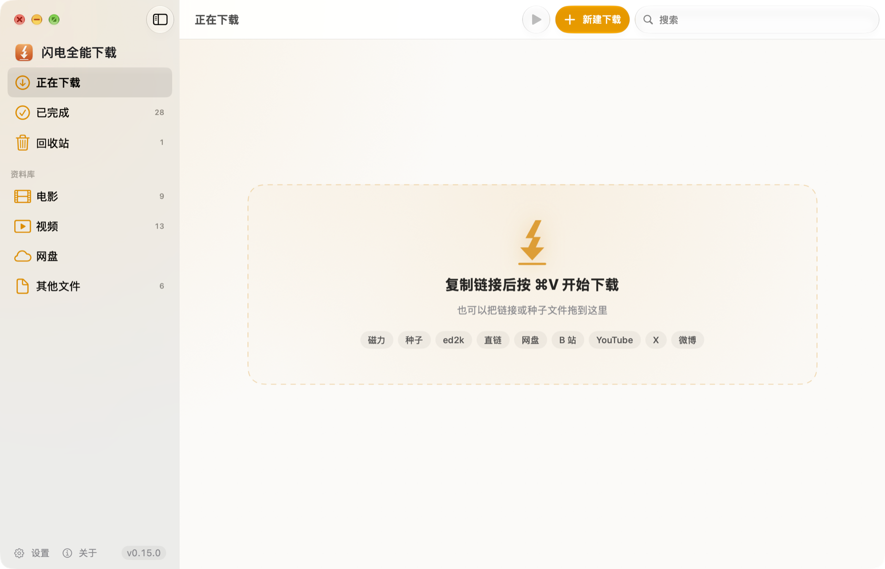

<div align="center">


# 闪电全能下载

Mac 上的下载工具，常用的下载渠道都能下




</div>

电影的磁力链接、种子，网页上的普通下载，网盘文件，还有 YouTube、B 站、抖音、小红书上的视频，都放进同一个窗口里下载。复制链接后按 ⌘V 就开始。

## 能下什么

| 想下的东西 | 怎么做 |
| --- | --- |
| 电影、剧集（磁力链接、种子、ed2k） | 复制链接按 ⌘V，或把种子文件拖进窗口 |
| 网页上的软件、文件 | 复制下载链接按 ⌘V；装了浏览器扩展后，在网页上直接点下载就行 |
| YouTube、X、B 站、微博的视频 | 复制视频页的链接，按 ⌘V |
| 抖音、小红书、新片场的视频 | 在浏览器里打开视频页，点浏览器扩展里的「下载这个视频」 |
| 百度网盘等网盘文件 | 需要另装 [LinkSwift](https://greasyfork.org/scripts/583582-linkswift) 脚本，在网盘网页里取得下载地址后交给闪电全能下载 |

视频默认下最高画质，格式选剪映、Final Cut 都能直接用的 H.264；抖音、小红书的视频没有水印。暂不支持视频号。

## 为什么更快

- **电影起速快**：自动从公开列表获取最新的 tracker（帮你找到正在分享这部片的人），并固定一个端口方便别人连进来。用公开片源实测，磁力链接 5–18 秒开始下载，迅雷非会员要 45–64 秒
- **普通文件多线路**：大文件分成几段同时下载；遇到服务器限流，会自动放慢重试，不会一直卡着
- **YouTube 4 路并发**：同时下载 4 段，实测速度约为普通下载的 2.5 倍
- **没人分享的冷门资源**：可以交给 PikPak 云盘先在服务器上下好，再从云盘拉回来（可选，需要 PikPak 账号）
- **境外网站自动走代理**：YouTube 等境外网站跟随系统代理设置，国内网站直连，不用手动切换

## 其他好用的地方

- **边下边看**：电影下载到一部分就能直接播放，拖动进度条时会优先下载那一段
- **关掉窗口照常下载**：顶部菜单栏显示当前速度；退出后再打开，未完成的任务接着下，不用从头开始
- **复制即弹**：在别的软件里复制了下载链接，右上角会弹出提示，点一下就开始下载
- **下完提醒**：下载完成时有通知和提示音

## 安装

需要 macOS 14 或更新版本，Apple Silicon（M 系列芯片）的 Mac。

### 方式一：一行命令（推荐）

打开「终端」，粘贴下面这行，按回车：

```bash
curl -fsSL https://raw.githubusercontent.com/chenmozhe008/shandian-download/master/script/install.sh | bash
```

它会下载最新版装进「应用程序」并打开，省掉系统「无法验证开发者」的拦截；如果装了 [Homebrew](https://brew.sh)，会顺手装上 ffmpeg（下载视频网站时用来合并画面和声音）。以后再运行一次就是更新。

### 方式二：让 AI 助手帮你装

用 Claude Code、Codex、WorkBuddy 等 AI 助手的话，把下面这段话发给它：

> 请帮我安装「闪电全能下载」（https://github.com/chenmozhe008/shandian-download）：在终端运行 `curl -fsSL https://raw.githubusercontent.com/chenmozhe008/shandian-download/master/script/install.sh | bash`。装好后，一步步告诉我怎么在浏览器里装它的扩展。

<details>
<summary>给 AI 助手的说明</summary>

- 安装脚本 `script/install.sh` 可以重复运行（覆盖旧版，旧版移到废纸篓）；要求 macOS 14+、arm64。加 `-s -- --no-ffmpeg` 可不装 ffmpeg
- 浏览器不允许程序自动安装扩展，这一步必须由用户操作：扩展文件夹在 `~/Library/Application Support/ShandianDownload/BrowserExtension`（App 第一次打开时生成）；用 `open -a "Google Chrome" chrome://extensions`（Edge 为 `edge://extensions`）打开扩展管理页，`open "$HOME/Library/Application Support/ShandianDownload"` 显示文件夹，再引导用户打开「开发者模式」、把 `BrowserExtension` 文件夹拖进页面
- 把链接交给 App 下载：`open -g "shandian://add?url=<URL 编码后的链接>"`（可带多个 url；加 `confirm=0` 不弹确认框）

</details>

### 方式三：手动下载

1. 在 [Releases](../../releases) 下载 `Shandian-版本号.zip`，解压后把 App 拖进「应用程序」
2. 第一次双击时，系统会提示「无法验证开发者」（这个 App 没有经过苹果公证）。点「完成」，打开「系统设置 → 隐私与安全性」，在页面下方点「仍要打开」。以后正常双击即可
3. 下载视频网站需要 ffmpeg：装了 Homebrew 的话，在终端运行 `brew install ffmpeg`

## 装浏览器扩展

**装了有什么用**：在网页上点下载时，文件会自动交给闪电全能下载，不用再复制链接；抖音、小红书、新片场的视频也要靠它下载。支持 Chrome 和 Edge，装一次就行，之后跟着 App 自动更新。

1. 在闪电全能下载顶部菜单栏选「闪电全能下载 → 浏览器扩展…」，在弹出的窗口里点「Chrome」或「Edge」，会打开浏览器的扩展管理页
2. 在扩展管理页打开「开发者模式」开关：Chrome 在页面右上角，Edge 在左侧栏
3. 回到闪电全能下载的窗口，点「显示文件夹」，把 `BrowserExtension` 文件夹拖进浏览器的扩展管理页

装好后，窗口里会显示「已连接」。

**下载视频**：打开视频页，点浏览器右上角的闪电全能下载图标，再点「下载这个视频」；也可以在视频画面上右键，选「用闪电全能下载」。

## 云盘离线（可选）

**有什么用**：有些电影在 BT 网络里几乎没人分享，速度一直是 0。这时可以交给 PikPak 云盘：它的服务器先把片子下好，再从云盘全速拉回你的电脑。

1. 注册一个 [PikPak](https://mypikpak.com) 账号，免费的就行
2. 在闪电全能下载的「设置 → 云盘离线（PikPak）」里登录：浏览器里已经登录着 PikPak 的话，点「从浏览器关联」即可（需要先装好浏览器扩展）；也可以点「在窗口里登录…」，在 PikPak 的官方登录页登录
3. 碰到卡住的任务，右键选「交给云盘离线」。也可以打开「磁力、种子太慢时自动交给云盘离线」，连续 3 分钟没速度会自动转过去

免费账号每天约 3 次、20 GB，云盘空间 6 GB。拉回电脑后会自动删除云端的文件。PikPak 没有公开接口，这项功能参照开源项目对接它的网页版，PikPak 改版时可能暂时失效。

## 常见问题

**打开时提示「无法验证开发者」**：见上面「方式三」第 2 步，或者用「方式一」的命令安装。

**YouTube 下不了**：下载境外网站需要本机开着代理，闪电全能下载会跟随系统代理设置。

**视频下完没有声音，或者提示合并失败**：没装 ffmpeg，在终端运行 `brew install ffmpeg`。

**云盘离线登录不上，或者从云盘拉回很慢**：PikPak 是境外服务，打开代理后再试。

**电影存到哪了**：默认在「下载 › 电影」，视频网站的视频和其他文件在「下载」。在设置里可以改。

## 从源码构建

```bash
swift build -c release                # 只编译 App
./script/build_engine.sh              # 编译下载内核（需要 Go，见脚本里的路径说明）
./script/build_app.sh package         # 打包成 dist/闪电全能下载.app
```

下载内核是打了补丁的 [Gopeed](https://github.com/GopeedLab/gopeed) v1.9.3，补丁在 `engine/shandian-gopeed-v1.9.3.patch`：重启不用重新校验、全局限速、边下边播、服务器限流时退避重试等。`build_engine.sh` 和 `build_app.sh` 里的路径是作者本机的，构建前请按自己的环境修改。

## 致谢

- [Gopeed](https://github.com/GopeedLab/gopeed)（GPL-3.0）：下载内核
- [yt-dlp](https://github.com/yt-dlp/yt-dlp)（Unlicense）：视频网站下载
- [FFmpeg](https://ffmpeg.org)：合并画面和声音

## 声明

仅供个人下载自己有权获取的内容，请遵守各网站的服务条款和当地法律法规。

## 许可证

[GPL-3.0](LICENSE)
